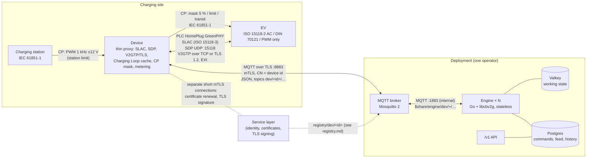
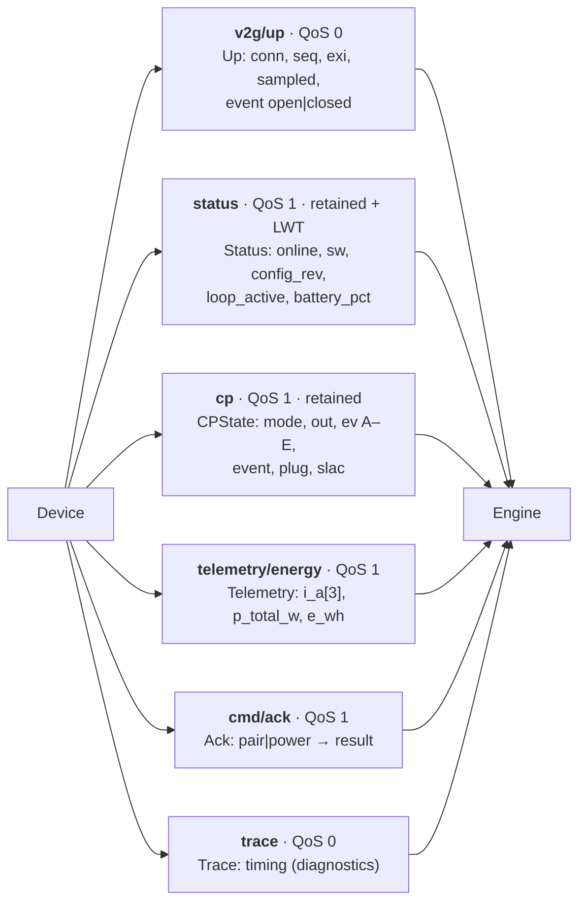
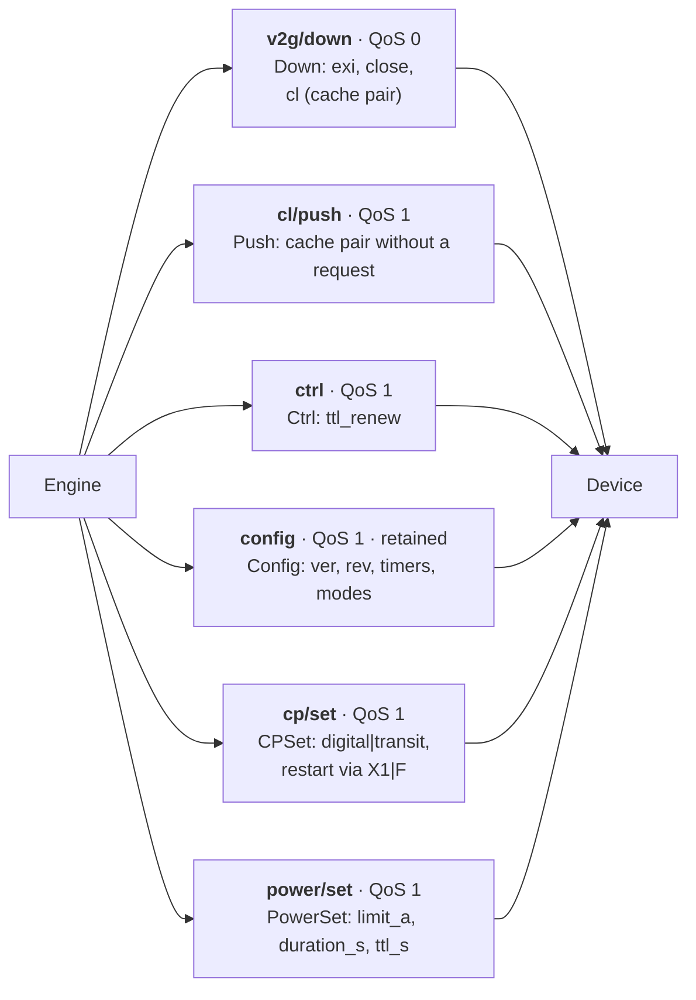
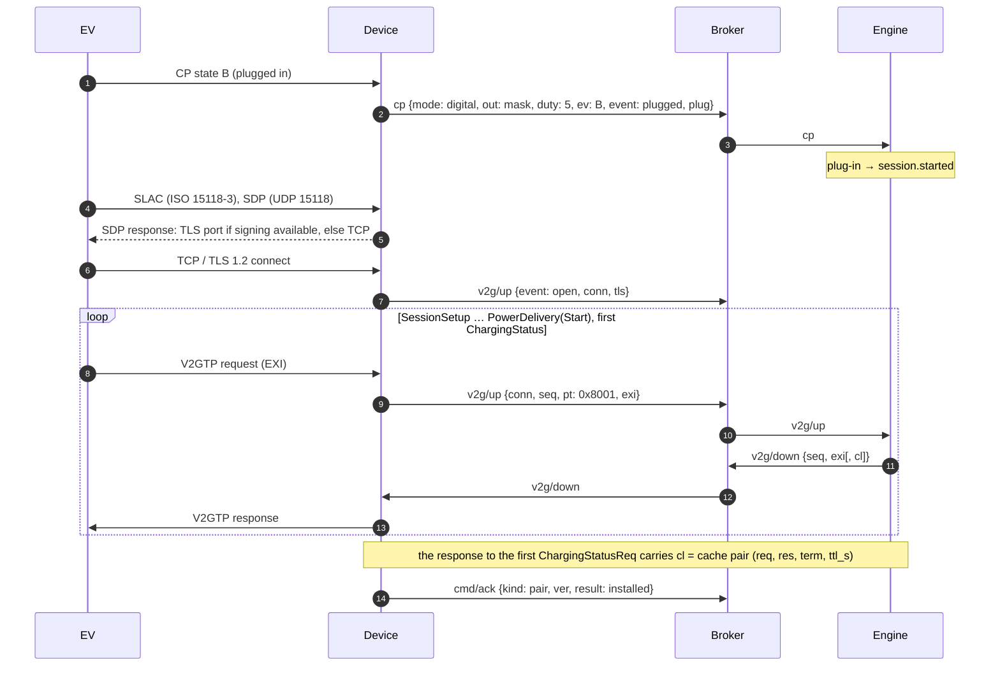
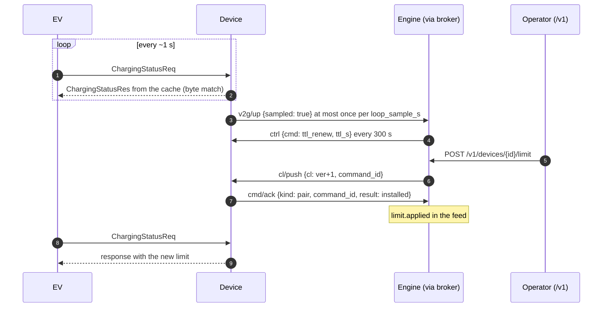
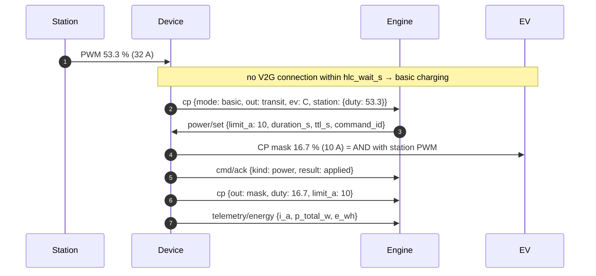
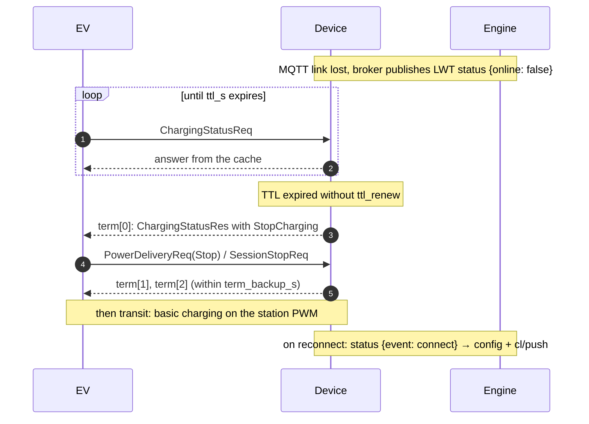

# Data flow: device ↔ server

How a device (an adapter between a charging station and an EV, or a module
inside a station) exchanges data with the EV and with the server of one
deployment.

- **Contract (source of truth):** [`spec/asyncapi-device.yaml`](../../spec/asyncapi-device.yaml)
  — AsyncAPI 3.0: topics, QoS, retain, payload schemas, enumerations, ports.
  This page shows the flows; field-level detail lives in the contract.
- **Code:** `engine/internal/tunnel` (message types), `engine/cmd/engine`
  (handlers), `engine/cmd/fleetgen` (a virtual device speaking the same protocol).
- **Related:** [registry.md](../registry.md) (service layer → server),
  [rules.md](../rules.md), [ADR-001](../adr/), ADR-003 (server time).

Other boundaries: [inside the deployment](dataflow-internal.md),
[service layer ↔ deployment](dataflow-service.md).

## 1. Overview

The device does not decode EXI and holds no ISO 15118 logic, limits or
history. The engine answers every EV request except the repetitive Charging
Loop, which the device answers from a **cache pair** (request bytes →
response bytes) the engine gives it. Session traffic never passes through the
service layer.

## 2. Topics

All topics are `dev/<id>/…`, where `<id>` is the CN of the device certificate.
The broker's ACL lets a device read and write its own subtree only.

**Device → server**

**Server → device**

| Topic `dev/<id>/…` | Direction | QoS | Retained | Message | When | Engine does |
|---|---|---|---|---|---|---|
| `v2g/up` | device → server | 0 | — | `Up` | session setup (~10 requests), end of session, cache misses; a loop sample once per `loop_sample_s` | steps the ISO / DIN state machine, answers on `v2g/down`; a `sampled` request is journalled, not answered |
| `v2g/down` | server → device | 0 | — | `Down` | answer to every request | — |
| `trace` | device → server | 0 | — | `Trace` | each delivered frame, only with `trace` on | debug journal |
| `cl/push` | server → device | 1 | — | `Push` | limit change during the loop; device reconnect | — |
| `ctrl` | server → device | 1 | — | `Ctrl` (`ttl_renew`) | every `DEVICE_TTL_RENEW_S` (300 s), by the leader | — |
| `config` | server → device | 1 | yes | `Config` | at connect and on change | — |
| `status` | device → server | 1 | yes | `Status`, LWT `{"online":false}` | at connect (`event: connect`), every `heartbeat_s` (60 s) | presence, `device.online/offline`; at connect sends config and the pair again; rule `supply` |
| `cp` | device → server | 1 | yes | `CPState` | every CP change | plug-in / unplug, basic charging, confirms a basic limit |
| `cp/set` | server → device | 1 | — | `CPSet` | mode change, final SoC read (DIN), supply window | — |
| `power/set` | server → device | 1 | — | `PowerSet` | operator limit in basic mode | — |
| `telemetry/energy` | device → server | 1 | — | `Telemetry` | every `telemetry_s` (60 s) while current flows, at once on ≥ 1 A change | `power.changed` in the feed; `telemetry` table |
| `cmd/ack` | device → server | 1 | — | `Ack` | pair or `power/set` taken over | `limit.applied` in the feed (first ack per `command_id` counts) |

Engine instances subscribe through the shared subscription
`$share/engine/dev/+/<topic>`; within one instance a device's messages are
handled in order, across instances they are not (ADR-001). Retained `cp` and
`status` replayed after a (re)subscription are not journalled twice.

## 3. Scenarios

### 3.1. Plug-in and digital session (ISO 15118-2 AC EIM)

### 3.2. Charging Loop from the cache, limit change, TTL

### 3.3. Basic mode (no HLC): limit through the PWM mask

### 3.4. Server unreachable

A cache miss while offline gets no answer; the EV ends by its own timeout.
Charging never stops because of the server: the worst case is transit of the
station PWM.

## 4. Enumerations

| Field | Values | Meaning |
|---|---|---|
| `Up.event` | `open`, `closed` | EV TCP/TLS connection opened / closed (`reason` with `closed`) |
| `Ctrl.cmd` | `ttl_renew` | extend the pair and limits by `ttl_s` |
| `CPState.mode` | `digital`, `transit`, `basic`, `X1`, `F`, `E` | requested CP mode |
| `CPState.out` | `mask`, `transit`, `X1`, `F`, `E` | applied towards the EV |
| `CPState.ev` | `A`–`E` | EV state, IEC 61851-1 |
| `CPState.event` | `plugged`, `unplugged` | plug-in boundaries (`plug`, `plugged_ms`) |
| `CPState.slac` | `UNMATCHED`, `MATCHING`, `MATCHED` | device's SLAC state |
| `CPSet.mode` | `digital`, `transit` | 5 % to the EV, or station PWM through |
| `CPSet.cmd` / `via` | `restart` / `X1`, `F` | CP restart pulse for `hold_s` |
| `Status.event` | `connect` | first status after (re)connecting |
| `Ack.kind` | `pair`, `power` | what is confirmed |
| `Ack.result` | pair: `installed`, `stale`, `rejected`; power: `applied`, `held`, `cleared`, `stale` | see the contract |
| `Up.pt` | `0x8001` | V2GTP payload type EXI |

## 5. Ports and transports

| Link | Transport | Port | Security |
|---|---|---|---|
| Station ↔ device ↔ EV | CP line, PWM 1 kHz | — | — |
| EV ↔ device | HomePlug GreenPHY (PLC), SLAC | — | — |
| EV ↔ device | SDP | UDP 15118 | — |
| EV ↔ device | V2GTP over TCP or TLS | TCP, port announced in SDP | TLS 1.2 `ECDHE-ECDSA-AES128-SHA256`, SECC key off-device (remote signing) |
| Device ↔ broker | MQTT 3.1.1 over TLS | TCP 8883 (`PUBLIC_TCP_PORT`) | TLS 1.2, client certificate under the deployment's root; ACL `dev/<id>/#` |
| Engine ↔ broker | MQTT 3.1.1 | TCP 1883, compose network only | account `server` |

## 6. Timers and defaults

| Setting | Default | Range | Where |
|---|---|---|---|
| `loop_sample_s` | 30 s | 0–600 | `Config`, `DEVICE_LOOP_SAMPLE_S` |
| `ttl_s` | 1 200 s | 60–3 600 | `Config`, `DEVICE_TTL_S` |
| TTL renewal | 300 s | TTL ≥ 2 × renewal | server, `DEVICE_TTL_RENEW_S` |
| `heartbeat_s` | 60 s | 10–600 | `Config`, `DEVICE_HEARTBEAT_S` |
| `term_backup_s` | 5 s | 2–30 | `Config` |
| `hlc_wait_s` | 30 s | 0–120 | `Config` |
| `telemetry_s` | 60 s | 1–600 | `Config`, `DEVICE_TELEMETRY_S` |
| ISO 15118-2 response budget | 1.5 s (EV timeout 2 s) | — | metric `engine_v2g_server_seconds` |

Per-device values: `PUT /v1/devices/{id}/config`; field list:
`GET /v1/config/fields`.
