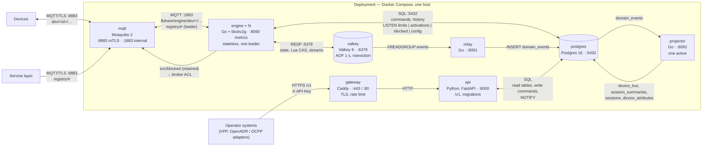
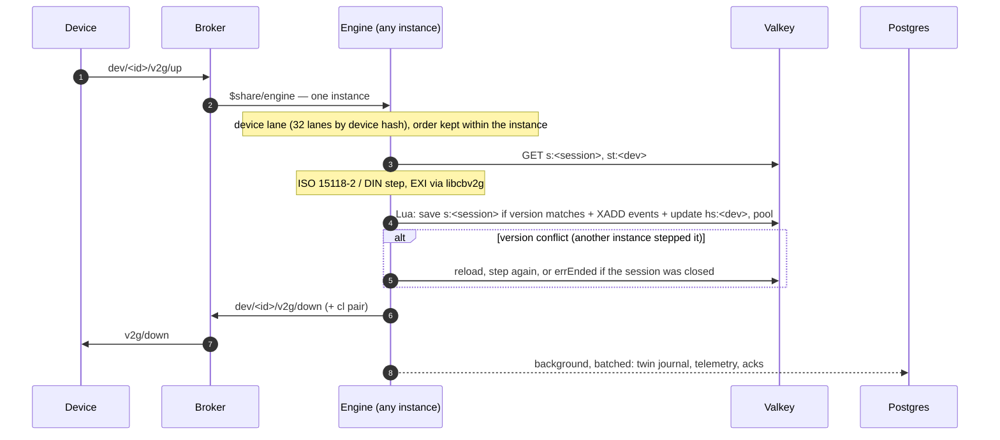
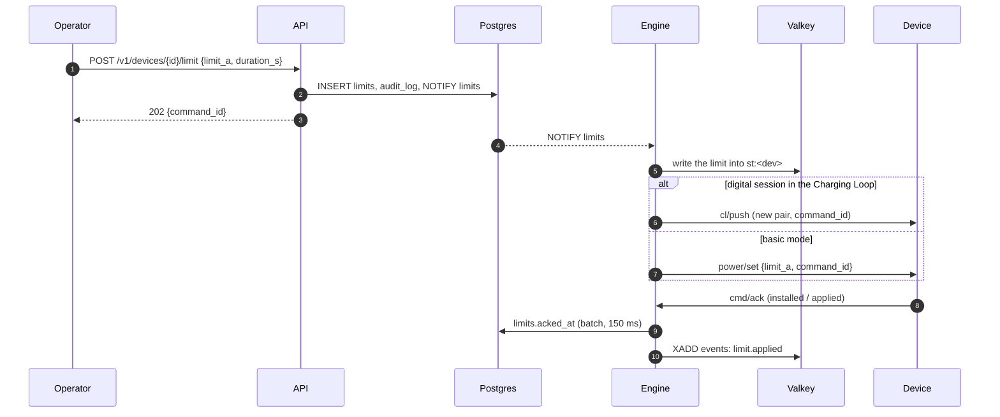
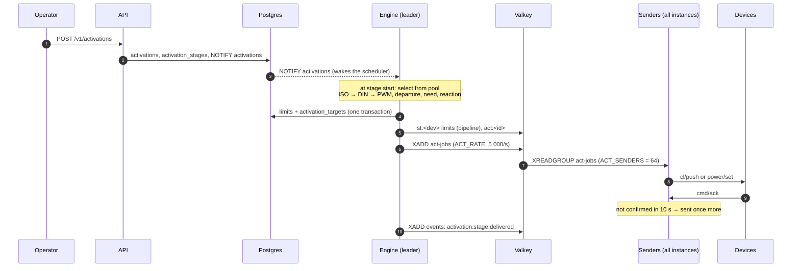
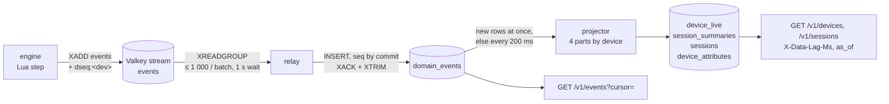

# Data flow: inside a deployment

How the parts of one deployment exchange data: broker, engines, Valkey,
relay, projector, Postgres, API, gateway.

- **Contracts at the edges:** device protocol
  [`spec/asyncapi-device.yaml`](../../spec/asyncapi-device.yaml), registry
  [`spec/asyncapi-registry.yaml`](../../spec/asyncapi-registry.yaml), operator
  API [`spec/openapi-operator.json`](../../spec/openapi-operator.json), event
  feed [`api/schemas/events.v1.json`](../../api/schemas/events.v1.json).
- **Inside**, the flows below are implementation, not a published contract:
  they may change between releases. The Valkey state contract is tested in
  `engine/cmd/engine/statecontract_test.go`; decisions: ADR-001 (message order),
  ADR-002 (working state in Valkey), ADR-003 (server time).
- **Related:** [dataflow-device.md](dataflow-device.md),
  [dataflow-service.md](dataflow-service.md), [metrics.md](../metrics.md).

## 1. Components and links

| Link | Technology | Data | Direction |
|---|---|---|---|
| engine ↔ broker | MQTT 3.1.1, :1883, account `server` | device topics through the shared subscription `$share/engine/…`; registry (leader, ordinary subscription); `svc/blocked` | both |
| engine ↔ Valkey | RESP, :6379; Lua scripts | session state with compare-and-set, station state, plug-in records, pool, event stream, activation jobs, coordination | both |
| engine ↔ Postgres | SQL, :5432; `LISTEN` | commands and their confirmations, device rows, settings, registry, telemetry, twin journal | both |
| relay | Valkey stream → Postgres | `events` → `domain_events`, at least once, no duplicates; `system.events_gap` on a lost tail | one way |
| projector | Postgres → Postgres | `domain_events` → tables the API reads | one way |
| API ↔ Postgres | SQL; `NOTIFY` | reads tables; writes commands, then `NOTIFY <channel>` | both |
| gateway → API | HTTP, :8000 | `/v1/*`, `/health` only | one way |

Nothing outside the deployment reaches Valkey, Postgres or the internal
listener; the only published ports are 8883 (MQTT) and 80/443 (HTTP).

## 2. A V2G request (hot path)

The EV gets most answers within 2 s (ISO 15118-2); the answer path never
touches Postgres (ADR-002).

## 3. Operator command: a limit on one device

## 4. Activation (group limit in stages)

## 5. Event feed and operator tables

Order within a device is `dseq`; the feed cursor is `seq` (by commit). The
feed keeps 30 days (`EVENTS_RETENTION_DAYS`); telemetry, the twin journal
(`events`) and the V2G journal (`messages`) keep 30 days too
(`HISTORY_RETENTION_DAYS`). Event types and fields:
`GET /v1/events/schema` = [`events.v1.json`](../../api/schemas/events.v1.json).

## 6. Signals inside the deployment

| Channel | Technology | From → to | Payload | Effect |
|---|---|---|---|---|
| `limits` | Postgres `NOTIFY` | API → engines | — (rows in `limits`) | the device's owner writes `st:` and sends a pair or `power/set` |
| `activations` | Postgres `NOTIFY` | API → leader | — | wakes the activation scheduler |
| `blocked` | Postgres `NOTIFY` | API (block), leader (registry `revoked`) → engines | — | all instances stop serving the device; leader publishes `svc/blocked` |
| `config` | Postgres `NOTIFY` | API → engines | — | new settings version → `dev/<id>/config` |
| `svc/blocked` | MQTT, retained | leader → broker | `v1 <id> <id> …` | `mqtt-run.sh` rewrites the device ACL, one reload per batch (3 s) |
| `events` | Valkey stream | engines → relay | event JSON, `dseq` | feed |
| `act-jobs` | Valkey stream, group | leader → senders | device, limit, command | activation delivery |
| `engines`, `engine-leader` | Valkey keys | engines | heartbeat 2 s, lease 6 s | membership, leader election |

## 7. Where the data lives

### 7.1. Valkey (working state, ADR-002)

| Key | Content | TTL | Written by |
|---|---|---|---|
| `s:<session>` | digital session state (state machine, version, ended flag) | 48 h, renewed by steps | engine, compare-and-set |
| `c:<dev>:<conn>`, `o:<dev>`, `open` | connection → session; open session of a device; devices with a session | 48 h | engine |
| `st:<dev>` | station settings and the limit in force (command, current, priority, end, source) | 1 h, then re-read from Postgres | engine, leader |
| `hs:<dev>` | plug-in record: mode, charging, power, departure, need, energy, reaction to limits, location | 48 h | event script |
| `pool` | devices available to activations | — | event script |
| `act:<id>` | devices taken by an activation | end + 1 h | leader |
| `events` | event stream | until the relay moves it (`EVENTS_STREAM_MAX`, `EVENTS_STREAM_HOURS`) | engines |
| `act-jobs` | activation send jobs | until acknowledged | leader |
| `dseq:<dev>`, `pw:<dev>` | per-device event number; last power | 48 h | engine |
| `engines`, `engine-leader` | live instances; leader lease | seconds | engines |
| `pool:seeded` | pool refilled from Postgres after an empty Valkey | — | leader |

### 7.2. Postgres

| Group | Tables | Written by | Read by |
|---|---|---|---|
| Commands and records | `devices` (binding, type, location, `rules`), `device_configs`, `limits`, `activations`, `activation_stages`, `activation_targets`, `api_keys`, `audit_log` | API, leader, engines (acks, presence, registry) | API, engines |
| Feed | `domain_events`, `relay_state` | relay | projector, API |
| Read tables | `device_live`, `session_summaries`, `sessions`, `device_attributes`, `projector_state`, `projector_orphans` | projector | API, leader (pool refill) |
| History | `telemetry`, `events` (twin journal), `messages` (V2G journal, debug devices only) | engines, background pool | API, debugging |

Migrations: `api/migrations`.

## 8. Periodic processes

| Process | Where | Interval |
|---|---|---|
| Twin journal, sent marks, background events | engine | 100 ms |
| Acks | engine | 150 ms |
| Telemetry | engine | 200 ms |
| Presence (changes only) | engine | 500 ms |
| Instance heartbeat, leader lease | engine | 2 s (lease 6 s) |
| Activation scheduler | leader | 50 ms while sending; 1 s while waiting for acks; else next event, ≤ 10 s, or `NOTIFY` |
| TTL renewal of pairs and limits (`ctrl`) | leader | 300 s |
| Feed and history retention | leader | hourly |
| Block list for the broker | leader | batches every 3 s |
| Stream read | relay | 1 s wait, ≤ 1 000 a batch |
| Feed read | projector | at once if new, else 200 ms |
