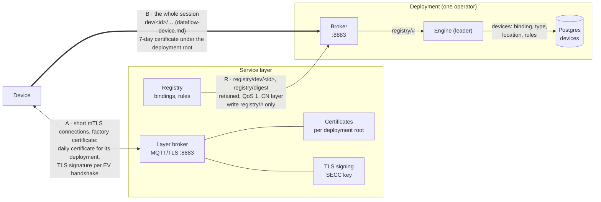
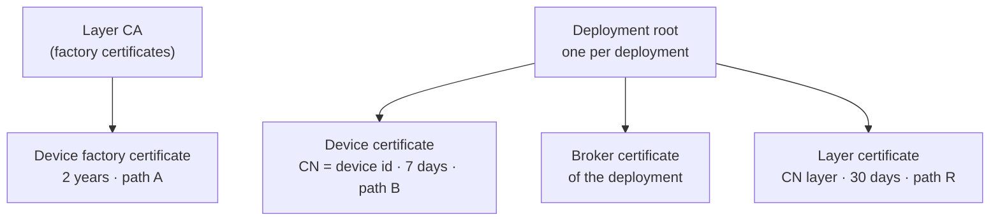
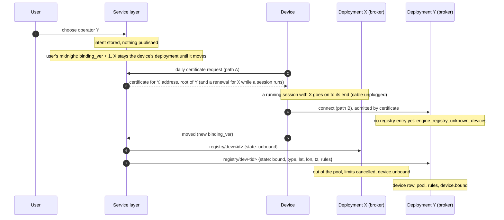

# Data flow: service layer ↔ deployment

What passes between the service layer, a deployment and a device, and what
does not.

The **service layer** issues device identities and certificates, decides
which operator a device belongs to, signs the TLS handshake with the EV for
the device (the long-term SECC key stays in the layer). It is a separate
service, not part of this repository. A deployment works without it
(`PKI_MODE=own`).

- **Contract (source of truth):** [`spec/asyncapi-registry.yaml`](../../spec/asyncapi-registry.yaml)
  — registry messages, fields, enumerations;
  [`spec/asyncapi-layer.yaml`](../../spec/asyncapi-layer.yaml) — the device's
  certificate for its deployment and the TLS signature (contour A, without
  the server).
- **Behaviour:** [registry.md](../registry.md) (defaults of the server, a move
  between operators), [rules.md](../rules.md) (business rules).
- **Related:** [dataflow-device.md](dataflow-device.md),
  [dataflow-internal.md](dataflow-internal.md).

## 1. Who talks to whom

| Path | Between | Transport | Authentication | Data | Frequency |
|---|---|---|---|---|---|
| **A** | device ↔ layer | MQTT over TLS to the layer's broker | factory certificate under the layer's CA (2 years) | certificate request (CSR) → certificate, deployment address and root; TLS signature request → signature ([`spec/asyncapi-layer.yaml`](../../spec/asyncapi-layer.yaml)) | short connections at the start of an EV session; one a day |
| **B** | device ↔ deployment | MQTT over TLS :8883 | certificate under the deployment's root, 7 days, renewed daily by the layer | everything of a session: V2G tunnel, cache pairs, CP, metering, commands | continuous |
| **R** | layer → deployment | MQTT over TLS :8883, the deployment's broker | certificate CN `layer` under the deployment's root, 30 days | binding state, type, coarse location (~100 m), time zone, business rules | on every change; digest once a day |

Not exchanged:

- the deployment never calls the layer, and the layer holds no operator
  secrets;
- session traffic (V2G, telemetry, commands) never passes through the layer;
- no personal data and no EV identifier reach the deployment from the layer.

## 2. Trust: certificates and roots

| `PKI_MODE` | Deployment root | Device certificates | Registry |
|---|---|---|---|
| `layer` | issued by the layer; `pki-init import` copies `ca.crt` and the broker certificate | issued by the layer from the device's CSR, same device key | from the layer (path R) |
| `own` | the deployment's own CA (`pki-init`) | `pki-init device <id>` or `pki-init sign <id> < csr` | optional: a device row appears at first connection; `scripts/registry.sh` publishes the same messages on the internal listener |

The broker trusts only the deployment's root: a certificate of another
deployment fails the TLS handshake. The device connects only to the address
it received with its certificate and pins the root that came with it.

## 3. Registry message

`registry/dev/<device_id>` — retained, QoS 1, one per device.

| Field | Type | Values |
|---|---|---|
| `v` | integer | 1 |
| `device_id` | string | certificate CN |
| `state` | enum | `bound`, `unbound`, `revoked` |
| `type` | string | reference only, e.g. `adapter`, `station`, `v2g-station` |
| `lat`, `lon` | number | 3 decimals, may be absent |
| `binding_ver` | integer | applied only if greater than the stored one |
| `at` | date-time | time of the fact, UTC |
| `tz` | string | IANA time zone of the user |
| `rules` | object | `rated_current_a`, `install_max_current_a`, `phases` (1, 3), `meter` (`clamp`, `certified`), `supply` {`below_pct`, `min_current_a`, `minutes`}, `topology` (`inline`, `integrated`); unknown keys kept |

`registry/digest` — `{v, bound, max_binding_ver, at}`, once a day.

## 4. Device moves from operator X to operator Y

An operator hears only of facts. A move takes effect from the user's
midnight; a running session ends with the operator it began with.

| Case | What the layer publishes |
|---|---|
| First binding | `bound` to the new deployment at once |
| Device off during the move | `unbound` / `bound` a day later (`MOVE_SILENT_H`), at the latest after 30 days |
| Revocation | `revoked` at once, to both deployments of a move |
| Field change (location, time zone, type, rules) | `bound` again with a greater `binding_ver` |
| Broker of a deployment unreachable | messages wait in the layer's queue, sent in order |

## 5. What the server does with it

| Message | Server (default) | Feed event |
|---|---|---|
| `bound` | device row, type, location, rules; back into the activation pool | `device.bound` |
| `unbound` | out of the pool, its limits cancelled; a running session goes on | `device.unbound` |
| `revoked` | served no more, at once (same barrier as a local block → `svc/blocked`, broker ACL) | `device.revoked` |
| digest differs | read the registry again | `system.registry_mismatch` |

A device with a valid certificate and no registry entry is admitted: the
certificate decides. Such devices: `GET /v1/devices?binding=none`, metric
`engine_registry_unknown_devices`.
