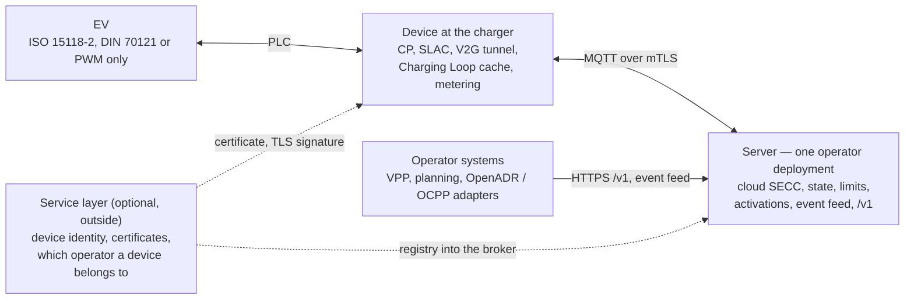

# Conceptual design

What the server is for, the ideas it is built on, and where its boundaries
are. Read this first; [architecture.md](architecture.md) then describes how one
deployment is built, and [architecture/](architecture/) holds the diagrams and
data flows.

## 1. Purpose

An EV that speaks ISO 15118 can tell the charger how much energy it needs and
when it leaves, and it can follow a charging limit set from outside. Putting a
full ISO 15118 stack (SECC) into every charger or adapter makes the device
expensive and hard to update, and the data and control stay in the box.

This server moves the SECC to the cloud. The device at the charger keeps only
what must be local — the control pilot, SLAC, TLS towards the EV where used,
metering — and tunnels the EV's V2G messages to the server. The server runs the
protocol for the whole fleet and gives one operator:

* the state of every plug-in: who is charging, how much energy is needed, when
  the EV leaves, how the EV reacts to limits;
* control: current limits on one device and staged activations across the
  fleet, confirmed by the devices;
* a record of what happened, as an event feed and as tables, over one API.

The intended use is demand flexibility from charging that is mostly residential
and overnight: balancing services such as mFRR and services to distribution
network operators. Frequency containment reserve is out of scope: it needs a
local reaction to grid frequency.

## 2. The concept in one picture

The C4 views (context, containers, engine components, deployment) are in
[architecture/c4-model.drawio](architecture/c4-model.drawio); open it in
draw.io (diagrams.net) or the draw.io extension for your editor.

## 3. Design principles

| # | Principle | What it means in practice |
|---|---|---|
| 1 | **The protocol lives in the cloud, the device stays simple** | The device carries no ISO 15118 session logic. It forwards V2G frames and answers the repetitive Charging Loop from a cache pair (request → response) that the server pushes, with a TTL. A new limit is a new pair. |
| 2 | **Charging never depends on the cloud being up** | If the server or the link is lost, the device answers from its cache until the TTL ends and then passes the station's own PWM through to the EV: basic charging by IEC 61851 ([dataflow-device.md](architecture/dataflow-device.md), §3.4). The cloud adds control and data; it is not needed to charge. |
| 3 | **The answer to the EV never waits on records** | Everything a session needs is working state in Valkey; Postgres holds commands, history and the operator's tables, written in the background ([ADR-002](adr/adr-002-working-state-in-valkey.md)). ISO 15118-2 gives the EV 2 s for most answers. |
| 4 | **Engines hold no state of their own** | Any engine instance can serve any message of any device; one device's steps are saved with a version check, so instances never overwrite each other ([ADR-001](adr/adr-001-device-message-order.md)). Event time is the server's, not the device's clock ([ADR-003](adr/adr-003-server-time.md)). |
| 5 | **A command is a record before it is a signal** | A limit or an activation is stored in Postgres, then applied from Valkey and sent; the device's confirmation is recorded. Every change becomes an event in a feed that is delivered at least once, without duplicates, in order per device. |
| 6 | **Identity and ownership are decided outside the server** | Which operator a device belongs to, its certificate and its business rules come from a service layer that publishes a registry into the deployment's broker. The server never calls the layer and holds none of its secrets. Without a layer the operator runs the deployment's own CA and keeps the registry with a script. |
| 7 | **One deployment, one operator** | No tenants, no groups, no routing between deployments. An operator sees only its devices by construction: only they have certificates under its root. |
| 8 | **Contracts at the edges, functional names inside** | Device protocol, registry, operator API and event feed are machine-readable contracts in [`spec/`](../spec/) and are checked in CI. Topics, settings, rules and events carry functional names only, the same in every edition of the server. |
| 9 | **Default behaviour, not a guarantee** | The server is open and the operator may change it. What it does on binding, unbinding or a change of operator is a sensible default; guarantees to the user (for example, a session in progress is not interrupted by a change of operator) are kept by the service layer and the device firmware. |

## 4. Boundaries

| | In this repository | Outside |
|---|---|---|
| Protocol | ISO 15118-2 AC with EIM, DIN 70121 (state of charge), IEC 61851 PWM | ISO 15118-20, DC, bidirectional power transfer, Plug & Charge (open, see [ROADMAP](../ROADMAP.md)) |
| Control | per-device limits, staged activations across the fleet, device settings, local block | charging schedules per device (planned), market bidding |
| Data | event feed by cursor, operator tables, history with retention | analytics, time series for billing, a user interface |
| Integration | `/v1` with keys and rights, the event feed, OpenAPI and JSON Schema | protocol adapters (OpenADR, OCPP, buses): separate projects that use `/v1` and the feed ([adapters/](../adapters/README.md)) |
| Identity | admission by client certificate, ACL per device, the registry intake; own CA mode | the service layer: device identities, certificate issuing, the TLS signer, change of operator |
| Operation | one host, Docker Compose, manual scaling, metrics and probes, export and import | redundancy of single components, several deployments under one management, automatic scaling, Kubernetes — larger editions |
| Testing | unit and contract tests, the virtual fleet `fleetgen`, the load-test kit [`loadtest/`](../loadtest/README.md) | the end-to-end test environment (test service layer, test station, test EV): a separate repository |

## 5. Main scenarios

1. **A charging session.** The cable is plugged in; the EV and the server
   negotiate through the device; the server learns the energy need and the
   departure time; in the Charging Loop the device answers from the cache;
   on unplug the session and its energy go to the feed.
2. **An operator sets a limit** on one device through `/v1`; the device
   receives a new cache pair or a PWM setting and confirms it.
3. **An activation**: the operator asks for a staged limit across the
   fleet; the server picks devices from the pool (ISO 15118 first,
   then DIN, then PWM), sends the limits at a controlled rate and reports
   delivery stage by stage.
4. **Binding and change of operator**: the service layer publishes that a
   device is bound, unbound or revoked; the server admits or stops serving
   it. A change of operator takes effect at the user's midnight and not
   before the cable is unplugged ([registry.md](registry.md)).
5. **Failure of a component**: answers to EVs continue while Postgres, the
   relay or the projector are down; devices reconnect after a broker restart;
   the limits are listed in [architecture.md](architecture.md), "Limits".

The data flows of these scenarios are in
[architecture/dataflow-device.md](architecture/dataflow-device.md),
[architecture/dataflow-internal.md](architecture/dataflow-internal.md) and
[architecture/dataflow-service.md](architecture/dataflow-service.md).

## 6. Quality targets

| Quality | Target | Status |
|---|---|---|
| Answer time to the EV | within the ISO 15118-2 timeouts (2 s for most messages) | measured: p99 0.06–0.8 s, max < 2 s |
| Capacity of the reference host | stated from a measurement, not a target | 5 000 devices, 3 200 sessions at once on 2 dedicated vCPU / 8 GB ([architecture.md](architecture.md), "Configurations") |
| Activation | a stage of 2 000 devices delivered in seconds | 95 % confirmed within 7.3 s |
| Recovery | a broker restart does not stop charging | 5 000 devices back within 61 s, charging goes on from the cache |
| Operator data | tables trail the devices by ≤ 2 s, up to 5 s | by design |
| Design size | 20 000 devices, one session a day each | the larger figure is the design's, not a stated capacity |

## 7. Key decisions

| Decision | Where |
|---|---|
| Order of one device's messages across engine instances | [ADR-001](adr/adr-001-device-message-order.md) |
| Working state in Valkey; Postgres off the answer path | [ADR-002](adr/adr-002-working-state-in-valkey.md) |
| Event time is the server's | [ADR-003](adr/adr-003-server-time.md) |
| The registry is published into the broker; the server never calls the layer | [registry.md](registry.md) |
| Business rules travel with the registry and have defaults | [rules.md](rules.md) |
| Caddy is the only HTTP entry; the feed is read by polling a cursor | [architecture.md](architecture.md), [operator.md](operator.md) |
| What the server guarantees and what the operator does | [operator.md](operator.md) |
